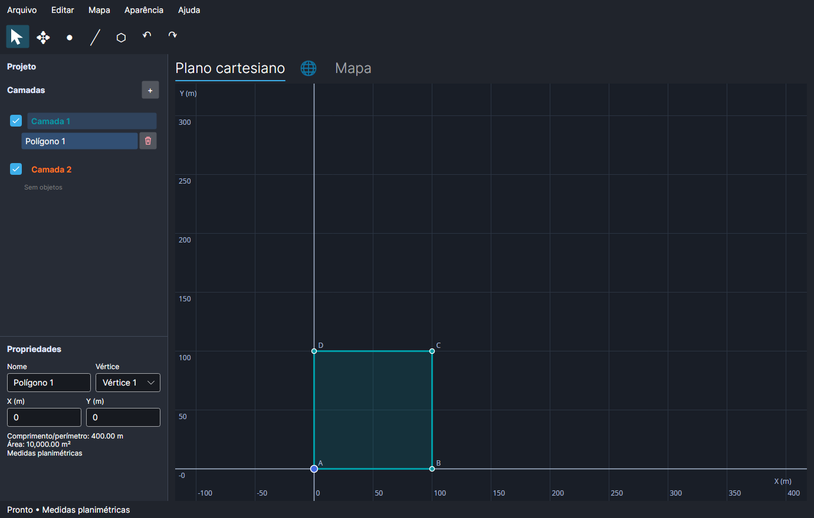
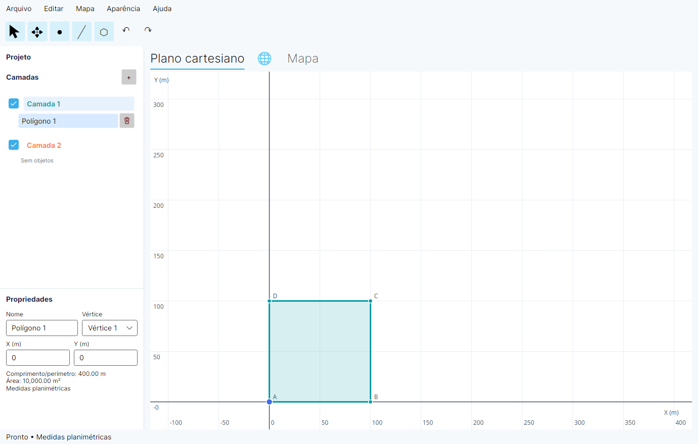
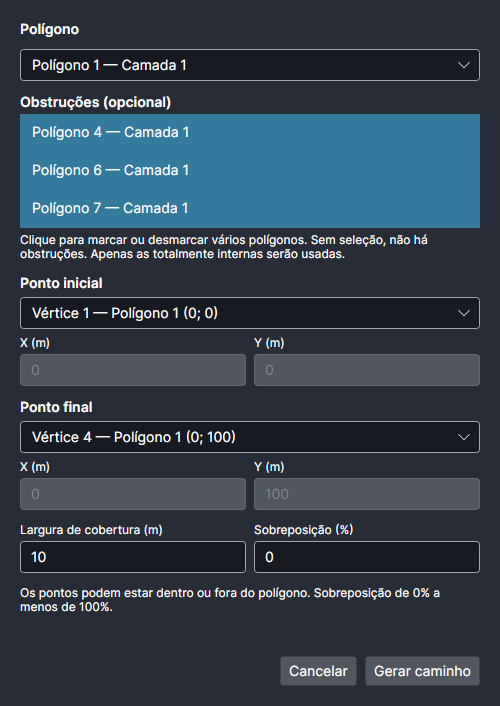
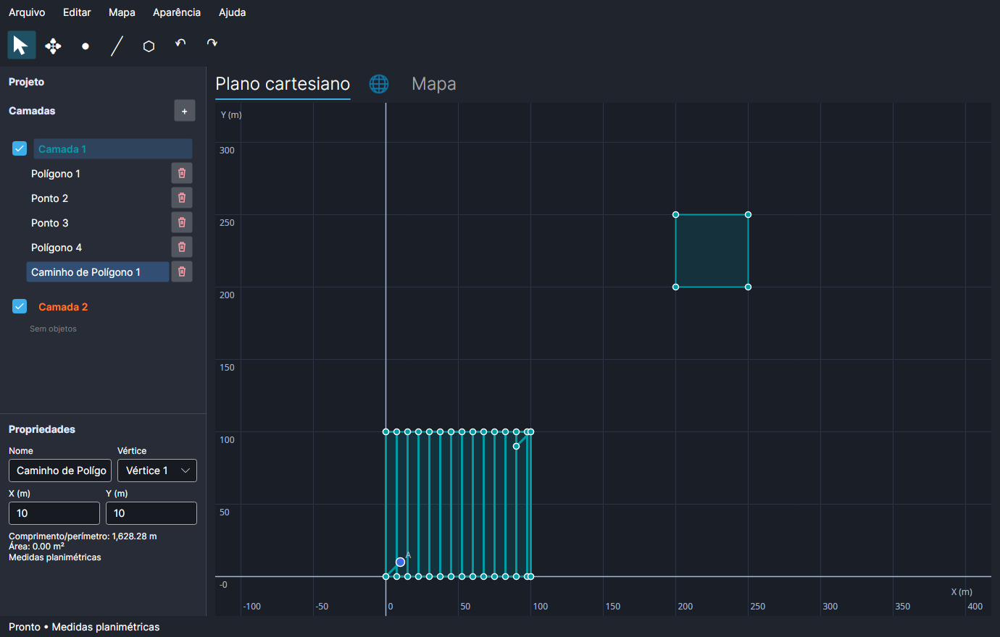

# Algetric

Desktop editor for local geometries with a Cartesian plane and an Earth globe, built with .NET 10 and Avalonia for Linux and Windows x64. The interface follows `mockups/example.png`.



*Edit polygons on the Cartesian plane, organize objects into layers, and inspect vertex coordinates, perimeter, and area.*

## Install on Linux

Install the native dependencies first. A published package includes the .NET runtime and does not require the .NET SDK or Node.js.

Arch Linux:

```sh
sudo pacman -S --needed proj gtk3 webkit2gtk-4.1 libsecret
```

Ubuntu 24.04:

```sh
sudo apt-get install libproj25 proj-data libgtk-3-0t64 libwebkit2gtk-4.1-0 libsecret-tools libgl1-mesa-dri
```

From this repository, install for your current user with:

```sh
bash scripts/install-linux.sh
```

This always builds the current source and then installs or updates the application, even if an older package already exists in `artifacts/linux-x64`. Building requires the source prerequisites below. To install an extracted Linux package instead, run this inside its directory:

```sh
bash install.sh
```

Run the installer without `sudo`. It copies the application into your user data directory, adds an icon and an **Algetric** entry to your applications menu, and creates `~/.local/bin/algetric`. You can open Algetric from the menu, pin it to your desktop environment's favorites, or run:

```sh
~/.local/bin/algetric
```

If `~/.local/bin` is already on your `PATH`, `algetric` works directly. The menu shortcut works independently of `PATH`. Installation copies all runtime and web assets, so the repository or extracted package can subsequently be moved or removed.

Close Algetric before updating. Update your checkout to the desired revision, then rerun the same command; it rebuilds and replaces an existing managed installation automatically:

```sh
bash scripts/install-linux.sh
```

From an updated extracted package, rerun `bash install.sh`; this uses the bundled version without requiring build tools. Installers use the current checkout or supplied package, rather than searching online for releases. Updates preserve projects, settings, credentials, and downloaded maps. To uninstall from the repository:

```sh
bash scripts/uninstall-linux.sh
```

Without the repository, use the installed uninstaller:

```sh
bash "${XDG_DATA_HOME:-$HOME/.local/share}/algetric/application/uninstall.sh"
```

Uninstalling removes the application, menu entry, icon, and command. Projects, settings, credentials, and downloaded maps are preserved. Installation honors `XDG_DATA_HOME`; `ALGETRIC_BIN_DIR` can override the command directory, which defaults to `~/.local/bin`.

## Install on Windows

Use the Windows x64 package `algetric-win-x64.zip`, produced by the Windows CI job or the publishing command below. Extract the ZIP, then double-click **install.cmd**. Algetric is installed for your current user without administrator privileges. Open **Algetric** from the Start menu and pin it to the taskbar if desired.

The package includes the .NET runtime, PROJ DLLs and coordinate database, native license notices, and local Cesium assets. Microsoft Edge WebView2 Runtime must be installed separately. If the installer reports it is missing, install the Evergreen Runtime from [Microsoft's WebView2 download page](https://developer.microsoft.com/microsoft-edge/webview2/#download-section), then rerun `install.cmd`. A standalone WebView2 installer is available for computers without internet access.

You can also install from PowerShell inside the extracted package:

```powershell
powershell.exe -NoProfile -ExecutionPolicy Bypass -File .\install.ps1
```

To create a desktop shortcut as well:

```powershell
powershell.exe -NoProfile -ExecutionPolicy Bypass -File .\install.ps1 -DesktopShortcut
```

The installer copies files to `%LOCALAPPDATA%\Programs\Algetric`, adds a Start menu shortcut, and registers Algetric in Windows **Installed apps / Apps & features**. Once installation succeeds, the extracted package can be removed. Close Algetric before updating, then run `install.cmd` from the newer package. The installer detects the registered installation, reuses its directory (including a custom `-InstallDirectory`), replaces application files, and preserves existing shortcuts and user data.

Uninstall through Windows Settings or double-click `uninstall.cmd` in the installed application directory. Projects, settings, encrypted credentials, and downloaded maps in `%LOCALAPPDATA%\algetric` are preserved. Provider tokens are encrypted with Windows DPAPI for the current user; copying the encrypted files to another Windows account does not transfer access.

To install or update from the repository on Windows, use the source prerequisites below and run:

```powershell
powershell.exe -NoProfile -ExecutionPolicy Bypass -File .\scripts\install-windows.ps1
```

This always publishes the current checkout before installing, even when `artifacts/win-x64` already exists. If publishing fails, the installed application is left untouched. No separate publish command is needed for this workflow.

### Build the Windows package

On Windows x64, install the SDK specified in `global.json`, Node.js 24, Git, CMake, and Visual Studio 2022 C++ build tools with the Windows SDK. Run from PowerShell in the repository:

```powershell
powershell.exe -NoProfile -ExecutionPolicy Bypass -File .\scripts\publish-windows.ps1
```

The publish script builds PROJ through a pinned vcpkg manifest, runs the tests, and creates `artifacts/algetric-win-x64.zip` with its SHA-256 checksum. Native builds use a static C runtime and dynamic PROJ/SQLite libraries, which are copied into the package together with `proj.db` and license files. No separate PROJ or .NET installation is needed on the target computer.

To reuse an existing native build, supply `-ProjRoot <triplet-directory>` to `publish-windows.ps1`. When developing with `dotnet run` directly, set `$env:AlgetricProjRoot` to that same directory before restoring and building so the native DLLs and database are copied to the output.

## Run from source

Linux source prerequisites: the SDK specified in `global.json` with the ASP.NET Core targeting pack, Node.js 24, PROJ and its database, WebKitGTK 4.1, GTK3, and WebGL acceleration. An X11 session or a Wayland session with XWayland must be available. Bearer credentials require `secret-tool` and an unlocked Secret Service.

Arch Linux:

```sh
sudo pacman -S --needed dotnet-sdk aspnet-runtime aspnet-targeting-pack nodejs npm proj gtk3 webkit2gtk-4.1 libsecret
```

Ubuntu 24.04 (also install the .NET SDK and Node.js):

```sh
sudo apt-get install libproj25 proj-data libgtk-3-0t64 libwebkit2gtk-4.1-0 libsecret-tools libgl1-mesa-dri
```

On Arch Linux, a distribution-provided SDK can report `arch-x64`. The shared build configuration selects the portable Linux apphost, avoiding a lookup for the nonexistent NuGet package `Microsoft.NETCore.App.Host.arch-x64`. No script flags or manual SDK changes are needed.

Run from the repository with one command:

```sh
bash scripts/run.sh
```

This prepares Cesium assets on the first run and starts the application through `dotnet run`. Arguments are forwarded, for example `bash scripts/run.sh --diagnostics`. You can still run the individual setup commands:

```sh
npm ci --ignore-scripts --prefix src/Algetric.Desktop/Web
npm run build --prefix src/Algetric.Desktop/Web
dotnet restore Algetric.sln --locked-mode
dotnet run --project src/Algetric.Desktop
```

Build the web assets before building the .NET application. The `Web/vendor` directory is generated from the Cesium package pinned in the npm lockfile. Its 22 MB of assets, including workers, fonts, and supporting files, are stored locally. No Cesium ion token is required.

## Usage

The interface is available in Portuguese and English. Open **Idioma / Language** and choose **Português** or **English** to switch immediately; the application remembers your choice for the next launch. Language changes preserve the project, object names, and editing history. New installations start in Portuguese. The instructions below use the English labels.

1. Set the origin through **Map → Geographic origin**, or choose **Set origin on map** and click the Earth. The default is São Paulo (−23.55°, −46.63°).
2. New projects start without layers. Create the first layer with **+** before drawing objects. Layers contain their objects as indented rows. Click a layer name to choose it for new objects; use **+** beside **Layers** to add a layer. Drag an object row onto another layer to move it. During the drag, a floating preview follows the pointer and the original row disappears. Dropping outside another layer, pressing **Esc**, or losing pointer capture restores the row. Transfers support undo/redo. Use the color wheel, brightness bar, and preview when creating a layer or editing it through **⋯**; no hexadecimal entry is required. Open **⋯** on a layer and choose **Delete layer** to remove it and its objects. Populated layers ask for confirmation; deletion can be undone. Create points, segments, polylines, or polygons by clicking the plane or map. Finish polylines and polygons with a double-click, Enter, or **Finish**. Esc cancels the drawing.
3. With **Select**, drag a vertex or the entire object. The sidebar shows name/vertex and X/Y side by side. Press **Enter** or leave a name or coordinate field to save the edit. Use the checkbox beside any object—point, segment, polyline, polygon, or generated coverage path—to hide or show it independently of its layer on both the plane and map. Hidden objects remain in the list and the project, and cannot be picked or selected by dragging an area in either view. Re-enabling a layer preserves each object's own visibility. Visibility is saved with the project and supports undo/redo. Delete an object with the trash icon beside its name; deletions can be undone.
4. Use the mouse wheel to zoom. On the plane, select **Move** and drag with the left mouse button, or hold **Space** to move temporarily. Releasing Space restores the previous tool and preserves unfinished lines or polygons. Right/middle mouse dragging also pans. Space works normally in text fields. The map uses Cesium navigation controls. The **Origin** button zooms into the working area.
5. Zooming below an altitude of 60 km changes the globe to a 2D map; zooming above 90 km returns to 3D. Tools and the sidebar remain accessible. Editing pauses during the animation.
6. Save projects as `.algetric` files. Ctrl+S saves, Ctrl+O opens, Ctrl+N creates a project, Ctrl+Z undoes, Ctrl+Y redoes, and Delete removes the selection. When leaving a modified project, you can save, discard changes, or cancel.

Local coordinates use meters in an ellipsoidal WGS84 azimuthal equidistant projection, transformed through PROJ. Measurements are **planimetric**, rather than geodesic. Editing is limited to a radius of 50 km from the origin and latitudes within ±80°. The origin becomes fixed after the first object is created, even if all objects are subsequently deleted. The globe remains navigable worldwide. Self-intersecting or degenerate polygons and invalid coordinates are rejected without replacing the last valid state.

The appearance follows the operating system theme by default. Use **Appearance** to choose a light or dark theme manually.

| Light theme | Dark theme |
| --- | --- |
|  |  |

## Coverage paths

Right-click a polygon on the plane, map, or its object row and choose **Generate point path**. You can also open the dialog from **Edit**. The context polygon is selected automatically; choose another polygon if needed, select existing start/end points, choose vertices of the selected polygon, or enter coordinates, and set the coverage width in meters and overlap percentage (0% to less than 100%). Endpoints may be inside or outside the polygon, within the project’s 50 km coordinate limit. External endpoints are joined to the nearest polygon boundary by straight entry/exit segments; the coverage route itself remains inside the polygon.

The optional **Obstructions** multiselect accepts other polygons; click an item to select or deselect it, and leave everything unselected for coverage without obstructions. Only polygons strictly inside the main area are sent to the planner. External, partially external, and boundary-touching polygons are silently ignored. Internal obstructions must not touch or overlap each other, and endpoints must not lie inside them. The generated route avoids their interiors.

<p align="center">
  
</p>

*Configure the polygon, optional obstructions, endpoints, coverage width, and overlap before generating a path.*

Generation runs in the background using `BoustrophedonDotnetWrapper` 0.1.4. The result is an editable path object in the polygon's layer, including the requested endpoints. Paths may revisit waypoints, are saved with the project, and support undo/redo as a single operation. Cancelling the dialog discards a pending result. Very dense requests are rejected when they would exceed 10,000 sweep lanes.



*A generated path without obstructions, selected for editing on the Cartesian plane.*

The current NuGet package supplies its native planner only for **Linux x64 with glibc**. Other desktop platforms can open and edit saved paths, but cannot generate new paths with this package version.

## Maps and offline use

Under **Map → Map provider**, configure an HTTPS raster XYZ server with `{z}`, `{x}`, and `{y}` placeholders, supported zoom levels, and attribution. Use your own server or a contracted provider that authorizes the intended use. No public server or paid service is preconfigured. Credentials must not be included in the URL; an optional Bearer token is stored in Linux Secret Service or encrypted with Windows DPAPI, separately from the project.

To download regions, enable the provider's offline permission and open **Map → Offline regions**. Enter a name, west/east/south/north bounds in degrees, and zoom levels. The size estimate assumes 40 KB per tile; actual storage depends on the images. Each region is limited to 50,000 tiles. Regions cannot cross the antimeridian.

Downloads can be interrupted and resumed from the region list, including after restarting the application. Stored tiles are not downloaded again. Downloads use up to three simultaneous requests, four attempts for HTTP 429/5xx responses, and respect `Retry-After`. Network or disk failures preserve committed tiles. Removing a region preserves tiles shared with other regions.

The map reads from the local SQLite store first, then requests missing tiles from the server. Online navigation does not automatically create persistent downloads. Without internet access, downloaded regions and geometries remain available; areas without tiles show a neutral background and a notice. Globe assets are local and do not require a network connection.

Configuration and maps are stored in `~/.local/share/algetric` on Linux or `%LOCALAPPDATA%\algetric` on Windows, using the data directory returned by the operating system. Projects contain only the origin, geometries, layers, styles, and view state. Maps and credentials are not included in project files.

## Verification and distribution

```sh
python3 -m unittest discover -s tests/installation -v
dotnet test tests/Algetric.Tests
npm test --prefix src/Algetric.Desktop/Web
dotnet run --project tests/Algetric.Smoke
dotnet run --project src/Algetric.Desktop -- --diagnostics
bash scripts/publish-linux.sh
```

The smoke test opens a real window and checks WebGL, synchronization, globe/map transitions, geographic editing, history, and persistence. It writes results to `artifacts/smoke`. In a headless environment, use `dbus-run-session -- xvfb-run -a` with Mesa. Unit tests use simulated HTTP providers and do not access external map services.

The final package is written to `artifacts/algetric-linux-x64.tar.gz`. Extract it and run `bash install.sh` to add it to your applications menu, or run `./Algetric.Desktop` directly. The package includes the .NET runtime; PROJ and WebKitGTK remain native system dependencies. See the [architecture](docs/architecture.md), [verification](docs/verification.md), and [license notices](THIRD_PARTY_NOTICES.md).

3D terrain, polygons with holes, and advanced GIS formats are outside the scope of this MVP.
